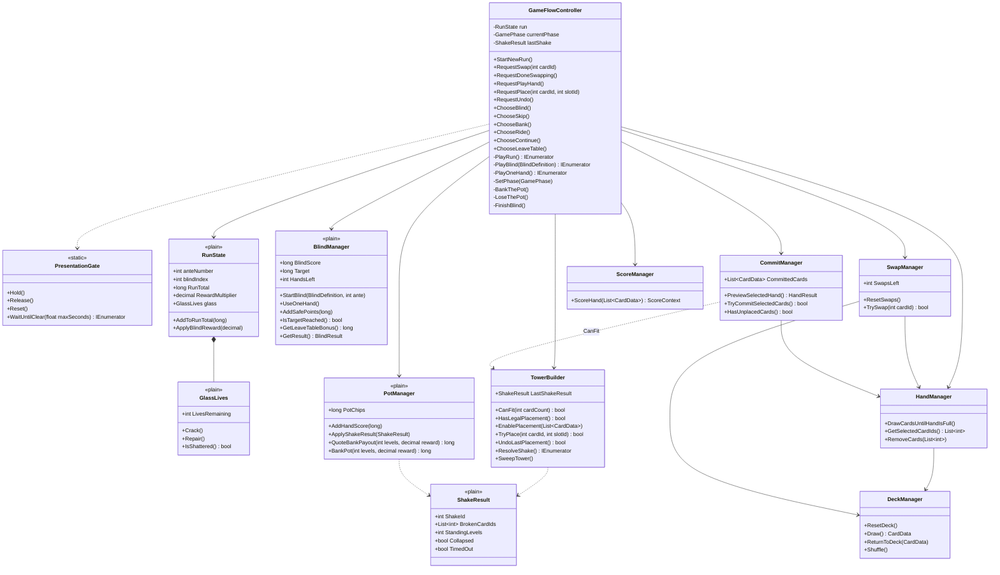
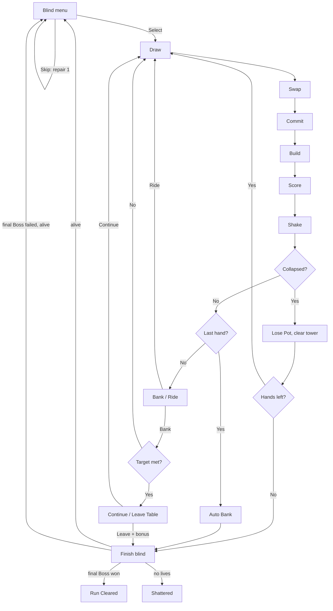

# Neo Tower of Cards — Master Plan

> **Read this first.** It is the build order and the code shape for the new prototype.
> **Date:** 2026-11-14 · **Revision 4** — Boss twists cut; revision 3 merged the two revision-2 drafts (see [§10 Change log](#10-change-log)).
> **Related docs:** [Core Gameplay Loop.md](Core%20Gameplay%20Loop.md) (player rules) · [juice-plan.md](juice-plan.md) (visual and audio details)
> **Who owns what:** Core Gameplay Loop owns the player rules. This plan owns the code and the work order. The juice plan owns the effects. Keep the three in step. Older GDDs describe the old prototype and do not override these.
> **Marks:** **⚙** = a number to tune. **Assumption** = a rule added to make the prototype buildable, not yet proven by play.

---

## 0. Where We Are

| Area | Status |
|---|---|
| Card placement, tower physics, poker scoring, hand, deck, single-card swap | ✅ Works. Keep it and check it still works after every step. |
| Commit step, Pot, Bank / Ride, Blinds, Glass lives | ❌ Designed, not built. |
| Juice | ❌ Planned, not built. Reuse the effects and assets that exist. |
| Known bug: two flow owners | Game over is decided in `TurnManager.EndTurn` **and** `TowerBuilder.CheckGameOver`. Both go; one conductor replaces them. |
| Known problem: late breaks | `TowerBuilder.BreakFallenCards()` breaks fallen cards when the *next* turn starts. That could change a payout the player was already offered. Fallen cards are now resolved at the end of the shake. |

**Goal:** prove that Bank vs Ride is easy to understand and interesting. Then build the full run. Then polish.

**Keep it small.** This is a prototype. Section [6.1](#61-what-must-exist-before-the-first-playtest) lists what must exist before the first playtest and what can wait.

---

## 1. The Rules We Are Building

### 1.1 Confirmed rules

- Draw up to 8 cards in hand. Unused cards stay for the next hand. Swap cards by selecting them and clicking the deck: up to 3 cards per hand ⚙, in one go or spread over several swaps (each card costs one swap).
- Commit 1–5 cards, then place **every** committed card. The poker score uses exactly that set.
- The hand score goes into the **Pot** (unsafe) before the shake.
- **Bank** makes the Pot safe and clears the tower. **Ride** keeps the Pot and the surviving tower.
- The height bonus is worked out again from the survivors each time. It is **never** stored into the Pot.
- Each broken card takes a percentage off the Pot, and the cuts stack. A collapse loses the whole Pot. A collapse never touches Safe Points and never cracks the Glass by itself.
- Each blind has its own `BlindScore`, starting at 0. `RunTotal` keeps every banked point and every Leave Table bonus, even from failed blinds.
- On the last hand, if the tower survives, the Pot is banked automatically. No Ride.
- **Reaching the target does not end the blind.** After a Bank, if the target is met and hands remain, the player may **Leave Table** for a bonus or **Continue**.
- A failed blind cracks the Glass once. Skipping a Small or Big blind repairs one crack, gives no score and no reward, and moves past that blind. A Boss cannot be skipped. Beating a Boss repairs one crack. Repairs never go above the maximum.
- The **Boss** is a plain blind: the third of each Ante, with the largest target and reward. It has **no twist**.
- A blind's reward changes future Banks only. It is applied once, when that blind ends in a win.

### 1.2 Assumptions added to close gaps

| Gap | Rule for the prototype |
|---|---|
| When is a hand spent? | When **Play Hand** is accepted, exactly once. A rejected commit, a swap, a selection change, or an undo spends nothing. |
| Tower is full | Ride is disabled. Show "Tower full — Bank to continue." A full tower is not game over. |
| Fallen but unbroken cards | At the end of the shake they count as broken (once each) and their slots are freed. Never wait until the next draw. |
| What is "collapsed"? | No base card is left standing. |
| What is a "standing level"? | A tier, counted up from the table without gaps, that has at least one complete supported tent (left + right). A flat floor card lets the next tier exist but adds no level. One lone base card stops a collapse but gives 0 levels. |
| Leave Table bonus | `floor(target × leaveBonusRate × HandsLeft)`, added straight to `BlindScore` and `RunTotal`. No height or reward multiplier. |
| Final Boss failed, Glass alive | Retry the same Boss: same target, fresh blind, one less life. |
| Run length | 4 Antes ⚙. Endless mode is a later decision. |

### 1.3 Score maths (exact)

Chips are whole numbers (`long`). Percent maths uses `decimal`, never `float`, because `float` gives off-by-one chips. `floor` = round down. **Round once at the end of each formula, never in the middle.**

> **Unity note:** the Inspector cannot show `decimal`. Store each rate in `GameConfig` as a whole-number percent (`breakPercent = 10`, `heightPercent = 10`, `leaveBonusPercent`, reward `120` for ×1.2) and convert in code: `breakPercent / 100m`.

```text
H = poker score of the committed cards
P = PotChips before + H
n = different cards broken this shake (fallen cards included)
b = break rate   (0.10 to start)
h = height rate  (0.10 to start)
L = standing levels after the shake
R = run reward multiplier (starts at 1)

Collapsed:      PotChips = 0
Not collapsed:  PotChips = floor(P × (1 - b)^n)        ← one rounding per shake

HeightValue = floor(PotChips × (1 + h × L))            ← shown in the breakdown only
BankPayout  = floor(PotChips × (1 + h × L) × R)        ← what Bank really pays
```

- `BankPayout` is **not** `HeightValue × R`. Work it out from `PotChips` in one go.
- Ride carries `PotChips` only. Never write the height value or the payout back into the Pot.
- Bank adds `BankPayout` to `BlindScore` and `RunTotal`, sets the Pot to 0, and clears the tower.
- Collapse beats penalties: if the tower collapsed, skip the break maths.
- The Pot number changes **once per shake**. Each broken card can still play its own sound and particles.
- After the shake the Pot shows **"Bank now: BankPayout"** with chips, height and reward as a breakdown. During the shake it shows the raw chips as "unsettled".

**Worked example** (use it as a test):

| Step | Maths | Result |
|---|---|---|
| Pot 200 + hand 102 | | P = 302 |
| 2 breaks at 10% | `floor(302 × 0.9²)` = `floor(244.62)` | PotChips = **244** |
| 2 levels | `floor(244 × 1.2)` = `floor(292.8)` | HeightValue = 292 |
| Reward ×1.2 | `floor(244 × 1.2 × 1.2)` = `floor(351.36)` | BankPayout = **351** |
| *The wrong way* | `floor(292 × 1.2)` | *350 — off by one* |
| Ride, then a Pair worth 52, no breaks, 2 levels | Pot = 244 + 52 = 296; `floor(296 × 1.44)` | BankPayout = **426** |

The earlier height bonus was never stored: the second payout starts from 244, not 292.

**Blind target:** `floor(baseTarget × targetGrowth^(ante − 1))`, always from the original base target, never from last Ante's rounded value. A final-Boss retry keeps the same target.

---

## 2. How the Code Is Shaped

### 2.1 One conductor, written as a coroutine

**The idea you wanted:** *"each method does one job, then hands off to the next."* We keep the small methods and clear names. We change one thing: methods do **not** call the next step themselves.

| Problem with a direct call chain | What goes wrong in a game |
|---|---|
| **It can't wait.** | Most steps wait for the player or for physics. A plain method can't pause, so you add timers and flags. That is how the game-over bug happened. |
| **Everything knows everything.** | `TowerBuilder` calls `ScoreManager` calls `UI` calls `Sound`. Change one, break the others. |
| **Jumping is hard.** | "The tower fell" or "that was the last hand" must skip ahead. In a chain every method must check every special case. |

Instead, `GameFlowController` (the **conductor**) is the only script that decides what happens next. It still reads like a chain, and every jump is visible in one place:

```csharp
IEnumerator PlayBlind(BlindDefinition definition)
{
    StartBlind(definition);
    while (blind.HandsLeft > 0 && !leftTable)
        yield return PlayOneHand();
    FinishBlind();          // win or fail, reward or crack, where to go next
}

IEnumerator PlayOneHand()
{
    yield return DrawPhase();        // fill the hand to 8
    yield return SwapPhase();        // until "Done Swapping"
    yield return CommitPhase();      // until "Play Hand" is accepted (the hand is spent here)
    yield return BuildPhase();       // until every committed card is placed
    yield return ScorePhase();       // score → Pot
    yield return ShakePhase();       // physics → one ShakeResult → Pot updated once

    if (lastShake.Collapsed)   { LoseThePot(); yield break; }   // jump: tower fell
    if (blind.HandsLeft == 0)  { BankThePot(); yield break; }   // jump: last hand auto-banks

    yield return BankOrRidePhase();  // Ride is disabled if the tower is full

    if (bankedThisHand && blind.IsTargetReached())
        yield return ContinueOrLeavePhase();                    // Leave sets leftTable = true
}
```

Every arrow in the flow diagram ([§3.1](#31-step-by-step)) is one line here. If an arrow has no line, the code is wrong.

### 2.2 The four roles

```
┌─────────────────────────────────────────────────────────────┐
│ INPUT    hand cards · deck · tower slots · menu buttons     │
│          send COMMANDS ("I want to…")                       │
└──────────────┬──────────────────────────────────────────────┘
               ▼
┌─────────────────────────────────────────────────────────────┐
│ FLOW     GameFlowController (the conductor)                 │
│          checks the phase, decides WHAT HAPPENS NEXT        │
│          PresentationGate (lets effects delay it)           │
└──────────────┬──────────────────────────────────────────────┘
               ▼ asks for work, gets a result back
┌─────────────────────────────────────────────────────────────┐
│ CORE     Deck · Hand · Swap · Commit · Tower · Score        │
│ workers  Pot · Blind · Glass · RunState                     │
│          check the rule, do the work, return the result     │
└──────────────┬──────────────────────────────────────────────┘
               ▼ GameEvents (announcements)
┌─────────────────────────────────────────────────────────────┐
│ VIEW     HUD · Sound · Juice                                │
│          only listen and show                               │
└─────────────────────────────────────────────────────────────┘
```

1. **Workers never decide what is next.** They do a job and return a result.
2. **Commands go to the conductor, not to workers.** This is true for hand cards, the deck and tower slots too, not only menu buttons. The conductor checks the phase; the worker checks the rule. A greyed-out button is feedback, it is not the safety check.

```csharp
public void RequestPlayHand()
{
    if (currentPhase != GamePhase.Commit) return;     // wrong phase: ignore the click
    if (!commit.TryCommitSelectedCards()) return;     // worker says the commit is not legal
    blind.UseOneHand();                               // spent exactly once
    playHandAccepted = true;                          // CommitPhase is waiting for this
}
```

3. **Requests are direct calls. Events are announcements.** Events tell the HUD, sound and juice what already happened. An event must never be the thing that moves the game forward.
4. **Juice sends no commands.** A view with a button may. A wobble effect may not.

### 2.3 The presentation gate

Some effects should finish before the game moves on (cards flying in, the score rolling up). The flow must not call juice, so juice asks the flow to hold:

```csharp
public static class PresentationGate            // the only FLOW thing juice may call
{
    static int holds;

    public static void Hold()    => holds++;
    public static void Release() => holds = Mathf.Max(0, holds - 1);
    public static void Reset()   => holds = 0;   // call on new run and on scene exit

    public static IEnumerator WaitUntilClear(float maxSeconds)
    {
        float deadline = Time.time + maxSeconds;
        while (holds > 0 && Time.time < deadline) yield return null;
        holds = 0;   // an effect that forgot to Release can't freeze the game
    }
}
```

```csharp
IEnumerator ScorePhase()                         // conductor
{
    SetPhase(GamePhase.Score);
    ScoreContext result = score.ScoreHand(commit.CommittedCards);   // fires HandScored
    pot.AddHandScore(result.Total);                                 // fires PotChanged
    yield return PresentationGate.WaitUntilClear(config.maxPresentationWait);
}

IEnumerator RevealScore(ScoreContext result)     // juice, started from the HandScored listener
{
    PresentationGate.Hold();
    yield return RollNumbers(result);
    PresentationGate.Release();
}
```

- **No juice in the project** → nobody holds → the wait ends at once → the game still works.
- The gate can only **delay**. It cannot give points, move cards, or pick the next phase.
- Player input stays blocked while the gate is held.
- The basics are **not** juice: the buttons, the hand layout, which cards are selected, the current numbers. They must work with every effect script deleted.

### 2.4 Who owns what

| Class | Owns | Must not own |
|---|---|---|
| `GameFlowController` | The phase, the run/blind/hand loops, accepting commands, the order of things | Poker maths, slot geometry, tweens |
| `RunState` + `GlassLives` (plain C#) | Ante and blind index, `RunTotal`, reward multiplier, lives | Phase changes, UI |
| `GameConfig` (ScriptableObject) | All ⚙ numbers | Anything that changes during a run |
| `BlindDefinition` (ScriptableObject) | Name, base target, reward, can-skip | Progress of the blind being played |
| `BlindManager` (plain C#) | `BlindScore`, `HandsLeft`, target, win/fail result, leave bonus | Starting the next blind, cracking the Glass |
| `DeckManager` | The 52 card instances, draw pile, reset, shuffle | Phase changes |
| `HandManager` | Cards in hand, selection, basic layout, reorder | Draw animation, totals |
| `SwapManager` | Swapping the selected cards, swaps left | Phase changes |
| `CommitManager` | Hand preview, the locked committed set, which are still unplaced | Spending the hand, animation |
| `TowerBuilder` | Placement, slots and support, the shake, `ShakeResult`, sweep | Game over, score penalties, UI calls |
| `ScoreManager` + `PokerHandEvaluator` | The score of one hand | The Pot, safe totals, the reveal animation |
| `PotManager` (plain C#) | Raw `PotChips`, applying a `ShakeResult`, quoting and paying a Bank | Glass, blind progress |
| Views | Show state, show which actions are legal, send commands | Changing core fields directly |
| Juice / Sound | Effects from events | Colliders, card ownership, points, commands |

### 2.5 Class diagram (core)



### 2.6 Events

- **Use a card ID, not a hand position,** for selection, commit, breaks and ownership. Reordering the hand must not change which cards are selected.
- **Count each break once.** Keep the broken card IDs of the current shake in a `HashSet`. A second callback for the same card adds nothing.
- Fire payout and result events **after** the change is done, and include old value, new value and the reason. The HUD must never redo the rule maths.
- Subscribe in `OnEnable`, unsubscribe in `OnDisable`. Clear the static events on load (rule 8).

| Event | Carries |
|---|---|
| `PhaseChanged` | new phase |
| `HandChanged`, `HandReordered` | card IDs in order |
| `SelectionChanged` | selected IDs, live `HandResult` preview |
| `CardDrawn` | card, hand index |
| `CardSwapped` | old card, new card |
| `HandCommitted` | cards, `HandResult` |
| `CardPlaced` | card, world position |
| `HandScored` | `ScoreContext` (fixed breakdown) |
| `CardBroken` | card, world position (for local effects only) |
| `ShakeResolved` | `ShakeResult` |
| `TowerCollapsed` | — |
| `PotChanged` | old chips, new chips, reason, current Bank quote |
| `PotBanked` | payout, new `BlindScore`, new `RunTotal` |
| `BlindOffered`, `BlindStarted` | `BlindDefinition`, target |
| `BlindWon`, `BlindFailed`, `BlindSkipped` | blind score, target |
| `GlassChanged` | old lives, new lives, reason |
| `RunEnded` | `RunTotal`, cleared or shattered |

---

## 3. The Full Flow and Its Edge Cases

### 3.1 Step by step

| Step | What happens |
|---|---|
| Blind menu | Only the current blind can be picked; later ones are previews. **Select** starts it. **Skip** (Small/Big only) repairs one crack and moves on one blind. |
| Start blind | Empty Pot, tower and hand. Reset and shuffle all 52 cards. `BlindScore` = 0, hands reset. Keep `RunTotal`, reward and Glass. |
| Draw | Fill the hand to 8. Reset swaps. |
| Swap | Select up to 3 cards (as many as there are swaps left) and click the deck to swap them all at once. Each card costs one swap. **Done Swapping** moves on. Swapping is never forced. |
| Commit | Select 1–5, see the hand name. **Play Hand** is accepted only if the cards can all be placed ([§3.2](#32-a-commit-must-be-finishable)). Accepting locks the set and spends one hand. |
| Build | Place the committed cards. Physics is frozen. Undo works on this hand's placements only. Nothing is scored yet. |
| Score | Score the committed hand once and add it to the Pot. |
| Shake | Release physics, watch, then produce **one** `ShakeResult` and update the Pot **once** ([§3.3](#33-the-shake-has-a-time-limit)). |
| Collapsed | Pot = 0, clear the debris. No Bank/Ride. Next hand if any; otherwise finish the blind on the points already safe. |
| Survived, last hand | Penalties, then automatic Bank, then finish the blind. |
| Survived, hands left | **Bank / Ride.** Ride is disabled if no legal placement is left. |
| Ride | Keep the raw Pot and the frozen survivors. Next hand. |
| Bank | Pay out, clear the tower. If the target is met: **Continue / Leave Table**. Otherwise next hand. |
| Leave Table | Add the unused-hand bonus once. The blind ends as a win. |
| Finish blind | Compare `BlindScore` with the target. Win → apply the reward once (and repair once on a Boss). Fail → crack once. Then: next blind, final-Boss retry, Run Cleared, or Shattered. |



### 3.2 A commit must be finishable

**Do not cap the commit at the number of open slots.** Each card placed can open a new slot (the other side of a tent, a floor, a new tier), so 3 open slots can still take 5 cards.

- **Before accepting Play Hand,** `TowerBuilder.CanFit(n)` searches the slot/support rules for *any* order that fits all `n` cards (at most 5 deep; logic only, no physics). If none exists, reject the commit, spend nothing, say why, let the player reselect.
- **Undo** removes this hand's latest placement, returns that card to "unplaced", and recalculates the slots. It cannot touch cards from earlier hands and cannot change the committed poker hand.
- **Never score a partial hand.**
- After the shake, rebuild the slots from what survived. No legal placement → Ride disabled.

### 3.3 The shake has a time limit

`ResolveShake` does not wait forever for Rigidbodies to sleep.

| Setting | Start ⚙ | Why |
|---|---|---|
| Minimum time | 1.0 s | Let physics act first. |
| Quiet time | 0.5 s in a row | Ignore a card that is still for one frame. |
| Speed limit | 0.05 units/s | "Quiet" for movement. |
| Spin limit | 0.10 rad/s | "Quiet" for rotation. |
| Maximum time | 6.0 s | Stop endless jitter from hanging the game. |
| Fallen pose | existing `fallenDistance` / `fallenAngle` | Is the card still where it should be? |

Count time in physics steps (`FixedUpdate`), so pausing does not use up the window. Visual fragments are not tower cards and are not watched.

When the tower is quiet, or the maximum time is reached, do these **in this order**:

1. Finish collecting impact breaks.
2. Check each surviving card from the bottom up: is it in its pose, and does it have support all the way down to the table? A floating card is not a survivor.
3. Count fallen and unsupported cards as broken. Do not start another wait.
4. Work out **collapsed** (no base card standing) and the **standing levels**. A timeout is not a collapse.
5. Freeze the survivors **where they are**. Do not snap them back to ideal poses.
6. Build the `ShakeResult`, remove debris, rebuild slots, update the Pot once, fire `ShakeResolved`, then offer the choice.

After step 6 nothing may change that payout. Sweeping the tower after a Bank never counts as a break.

### 3.4 Where a card can be

A card is in exactly one place: draw pile, hand, committed (unplaced), tower, or spent. An animation copy is not a real card.

- **Swap:** draw the new cards first, then return the old ones to the draw pile. Check the cards are available before starting. Never half-finish a swap.
- Played, broken and swept cards stay spent until the next blind. Bank does not refill the hand, swaps, deck or hands left.
- A new blind (or a retry) restores all 52 cards.
- With today's numbers the deck cannot run out (4 hands: 8 + 3×5 drawn + 12 swaps = 35 cards). In `GameConfig.OnValidate`, warn if a change makes it possible.

---

## 4. Coding Rules (for everyone, including future AI helpers)

1. **One class = one job.** Quick test: can you say it in one sentence without "and"? The real test: does it have only one reason to change?
2. **Method names say what they do:** a verb plus a thing. `TryCommitSelectedCards()`, `ApplyShakeResult()`, `QuoteBankPayout()`. Not `Handle()`, `DoStuff()`, `Check2()`.
3. **Short methods.** Over about 20 lines, stop and ask if it should split. One clear transaction (like Bank) may stay together.
4. **Only `GameFlowController` changes the phase.** Workers return results. Events announce.
5. **Every command is checked twice:** the conductor checks the phase, the worker checks the rule. Accept it once; ignore double-clicks and clicks from an old phase. Clear the stored choice when a phase starts.
6. **Juice only listens.** It never changes score, Pot, cards or state. Its one allowed call is `PresentationGate.Hold()` / `Release()`. Deleting any juice script must leave the game playable. That's the test.
7. **Never tween a physics card.** Tower cards with a Rigidbody move only by physics. Hand effects move the `Visual` child, never the root. Sweep effects use visual copies after the real cards are gone.
8. **Always unsubscribe** (`OnEnable` → `OnDisable`). As a backstop, `GameEvents` clears itself in a `[RuntimeInitializeOnLoadMethod(RuntimeInitializeLoadType.SubsystemRegistration)]` method. Do **not** clear events in `StartNewRun()`; that removes listeners that just subscribed.
9. **⚙ numbers live in `GameConfig`,** never in code. Check the ranges in `OnValidate`.
10. **Composition over inheritance.** Add an interface only where things truly share behaviour, not for every helper.
11. **Rules maths is plain C#,** not MonoBehaviour: `RunState`, `GlassLives`, `PotManager`, `BlindManager`. The conductor creates them and passes in `GameConfig`.
12. **Rules maths has EditMode tests** ([§7.1](#71-editmode-tests)).
13. **Every wait has a time limit,** except waiting for the player. On a new run or scene exit, stop the flow coroutine and call `PresentationGate.Reset()`.
14. **Every phase starts with `SetPhase(...)`.** It fires `PhaseChanged` and logs the name. An exception inside a coroutine stops it silently; the last logged phase shows where.
15. **One of each per hand:** one hand spent, one score, one shake result, one payout, one blind reward.

---

## 5. Boss Blind

The Boss is the third blind of each Ante. It is a plain blind with the largest target and the best reward. It cannot be skipped, a win repairs one Glass crack, and winning the final one clears the run.

**Twists are cut from the prototype** (Tremor, Heavy Card, Glass Pot, Short Fuse). There is no `IBossTwist`, and no blind changes the rules. Bring them back only after P2 shows the plain run is fun.

---

## 6. Work Order

Each step ends with **"✔ Done when"**, something you can see by playing. Don't start the next step until it passes. Commit after every step.

### 6.1 What must exist before the first playtest

The first playtest (P1) answers one question: *is Bank vs Ride interesting?* Build only what that needs.

| Needed for P1 | Can wait until A4 or later |
|---|---|
| Conductor, commands, `SetPhase` log | Blind menu, Glass, rewards, Antes, Leave Table |
| Commit with `CanFit` check and Undo | Rejecting single placements that lead to a dead end (Undo already covers it) |
| Exact Pot maths with tests | Hand IDs and shake IDs on every event (a `HashSet` of broken card IDs is enough) |
| Shake with time limit, fallen cards resolved at shake end | Automatic "restore and refund" recovery from an impossible state (use the debug restart key) |
| Bank, Ride, full-tower rule, last-hand auto-bank | Deck-exhaustion fallback (cannot happen with today's numbers) |
| Plain HUD: Pot, Bank quote with breakdown, breaks, levels, hands left, why a button is disabled | All Track C juice |

### 6.2 Track A — Core

| Step | Build | ✔ Done when |
|---|---|---|
| **A0. Baseline** ✅ *done, tag `good-A0`* | Branch `prototype-loop`; commit the working build. Add `GameEvents`, `GameConfig`, `PresentationGate`, empty `DebugCheats`, and the EditMode test assembly. | The game plays exactly as before. |
| **A1. Conductor** ✅ *done, tag `good-A1`* | Three commits, each playable (see [6.3](#63-existing-scripts) for why `TurnManager` is not deleted here).<br>**A1a:** add `GameFlowController`; switch `TowerBuilder`, `HandManager`, `ScoreManager`, `DiscardManager` and `GameUi` over to it. `TurnManager` becomes an empty, switched-off shell.<br>**A1b:** delete `CheckGameOver` and the next-turn break timing, so only the conductor decides game over.<br>**A1c:** play-test, run the scene checker, tell teammates. | No false game over. Play Again leaves exactly one conductor. A debug key restarts a full tower (until A3). The scene checker reports no Missing Script and no empty required field. |
| **B0. Hand contract** ✅ *done, tag `good-B0`* | One person: root + `Visual` child, card IDs, selection, basic layout and input. | The hand works with no juice. A2 and Track B both build on this. |
| **A2. Commit** ✅ *done, tag `good-A2`* | Select 1–5 → live hand name → Play Hand → `CanFit` → place only those cards → Undo. | A commit that needs newly opened slots is accepted. An impossible commit spends nothing. Every accepted build can be finished. |
| **A3. Bank / Ride** | `PotManager` + tests. `ResolveShake` ([§3.3](#33-the-shake-has-a-time-limit)). Full-tower rule, Bank, last-hand auto-bank. A light `BlindManager`: one fixed target, four hands, a Safe Points counter. `BankRideView` as a new script. | Normal hand, breaks, collapse, last hand and full tower all work with plain buttons. The worked example in §1.3 passes as a test. |
| **🎯 P1. Bank/Ride playtest** | Short sessions, you plus 2–3 other people. Log every choice ([§7.4](#74-playtests)). | Players can explain why they banked or rode, and both get chosen for a reason. **If one choice always wins, fix the rules before A4.** |
| **A4. Blinds, Glass, run** | Full `BlindManager`, `RunState`, `GlassLives` + tests. Blind menu, targets, Leave Table, Skip, rewards, 4 Antes, final-Boss retry. `BlindMenuView`, `GlassView`, `RunEndView` as new scripts. | Every branch works: win, fail, skip, retry, cleared, shattered. Safe totals and the life cap stay right. |
| **🎯 P2. Run playtest** | At least 10 full runs. Tune one group of numbers at a time. | Choices stay interesting across Antes. Leave/Continue and Skip/Play are understood. Ten runs is a first look, not proof of balance. |
| **A6. Clean-up** | Finish splitting `TowerBuilder`; move what is left of `GameUi` into `HudView` and delete it; remove dead code. | All scenarios in §7 pass. No second flow owner, no broken scene reference. |

### 6.3 Existing scripts

| Script | What happens to it |
|---|---|
| `TurnManager.cs` | Replaced by the conductor in A1a, but the **file stays as an empty, switched-off shell until A6**. `MainGame`, `Filly` and `Immer` each hold a `TurnManager` component, so deleting the file early leaves a Missing Script in teammates' scenes. The shell does nothing, so both are never running. |
| `TowerBuilder.cs` (647 lines) | Remove `CheckGameOver` and the next-turn break timing. Add `CanFit`, `HasLegalPlacement`, `ResolveShake`, `SweepTower`. Split out `TowerSlots` and `TowerPlacementInput` **when A2/A3 need it**, not only in A6. |
| `ScoreManager.cs` | Keep the scoring. It no longer owns the total. Any reveal animation moves to juice (C2). |
| `HandManager.cs` / `HandCardView.cs` | Card IDs, multi-select, `Visual` child (B0). |
| `DiscardManager.cs` | Rename to `SwapManager`. Rename inside Unity so the `.meta` file and scene references follow. |
| `GameUi.cs` / `FinalScores.cs` | New screens are new scripts when first needed. Remove each old display when its replacement lands. `GameUi` is deleted in A6. |
| `DeckManager`, `Card`, `CardData` | Reuse, but expect small changes: runtime ID, reset. |
| `PokerHandEvaluator`, `AudioManager` | Keep. Route sounds through events where needed. |
| `Card.Broken` | Becomes `GameEvents.CardBroken`. Remove the old subscribers so nothing is handled twice. |

### 6.4 Track B — Hand juice (after B0, alongside A2+)

| Step | Build (see [juice-plan.md](juice-plan.md)) |
|---|---|
| B1 | Hover shake · select punch · toggle-pop, all on `Visual` |
| B2 | 3D tilt toward the mouse · fan spread (hit targets stay stable) |
| B3 | Draw one by one with Bézier arc and flight tilt · snap punch. Holds the gate until the last card lands. |
| B4 | Plain reorder command first; then velocity tilt, mouse lag, neighbour glide |
| B5 | Weight and chips tooltip · deck feedback. Needed information must stay if the animation is removed. |

✔ **Done when:** removing every Track B script leaves drawing, selecting, reordering and placing usable.

### 6.5 Track C — Flow juice

C1–C5 react only to rules that P1 proves, so they **may start after P1**. C6–C8 need the full run, so they start **after P2**. **⏸** = holds the gate.

| Step | Build | Reads from |
|---|---|---|
| C1 | Live hand name slam | `SelectionChanged`, `HandCommitted` |
| C2 | **⏸** Score roll, mult punch, floating "+14" | `HandScored` |
| C3 | Break particles; Pot loss and shatter | `CardBroken` for effects; `ShakeResolved` / `PotChanged` for numbers; `TowerCollapsed` |
| C4 | Camera shake on collapse | `TowerCollapsed` |
| C5 | **⏸** Chips fly to Safe Points; tower sweep | `PotBanked` |
| C6 | **⏸** Blind menu slide-up, win and fail screens | `BlindOffered`, `BlindWon`, `BlindFailed`, `BlindSkipped` |
| C7 | Glass crack and repair | `GlassChanged` |
| C8 | **⏸** Run intro: cards fly in and form the deck | `PhaseChanged(RunIntro)` |

✔ **Done when:** removing every Track C script leaves the game fully working, just instant.

```
A0 ─ A1 ─ B0 ─ A2 ─ A3 ─ 🎯P1 ─ A4 ─ 🎯P2 ─ A6
            └─ B1 ─ B2 ─ B3 ─ B4 ─ B5
                           └─ C1 … C5      └─ C6 … C8
```

### 6.6 Safety net and schedule

**Git.** Work on `prototype-loop`; `main` stays at the last played build. Commit once per step (three for A1). After a step passes its check, tag it `good-A0`, `good-A1`, and so on, and push the tag. `good-baseline` is the last build before the rewrite: `git checkout good-baseline` gets it back. Merge to `main` only after P1 and again after P2. Move or rename scripts inside Unity so the `.meta` file follows. Only one person edits `MainGame.unity` at a time.

**Scene checker (build in A1).** An Editor menu tool that scans the open scene for Missing Scripts and empty required fields. Run it after every step. On start the conductor also checks every worker it needs and logs an error that names the missing one.

**Rules code lives in `Assets/Scripts/Rules/`** (assembly `TowerOfCards.Rules`) so EditMode tests can reach it. That code cannot use old scripts such as `CardData` directly; it works on plain numbers. Everything that touches scenes stays in the default assembly.

**10-day target.** Days 1–4: A0–A3. Day 5: P1, fix what it shows. Days 6–8: A4 plus the cheapest high-impact juice (C2, C3, B1). Day 9: a short P2 and tuning. Day 10: bug fixing only. Boss twists are cut; most of Track B and C and the A6 clean-up are the first things to drop if time runs out. Play-test the same day as each step.

---

## 7. Checking the Work

### 7.1 EditMode tests

Small, one idea each. They run without opening a scene.

| Class | Test |
|---|---|
| `PotManager` | The §1.3 example: Pot 244, quote 351, then 426 after the Ride. |
| | Two shakes with the same levels give the same height bonus (it never compounds). |
| | The same broken card reported twice counts once. |
| | A collapsed result leaves 0, whatever the break count. |
| | `BankPot` returns the quote and leaves 0. |
| `BlindManager` | `BlindScore` starts at 0 on every `StartBlind`. |
| | Target = `floor(base × growth^(ante−1))` from the base value. |
| | `IsTargetReached` flips exactly at the target. |
| | Leave bonus = `floor(target × rate × HandsLeft)`; 0 hands left gives 0. |
| `GlassLives` | Crack to 0 → shattered. Repair never goes above the maximum. |
| `RunState` | `RunTotal` keeps points from a failed blind. A reward is applied once per won blind. |

### 7.2 Play checks

| Situation | Must happen |
|---|---|
| Final hand survives with breaks | Penalties, one auto-Bank, then the result. No Ride offered. |
| Final hand collapses | Pot 0. The blind is judged on safe points. Crack only if it failed. |
| Target already met, then a collapse | Safe score stays. The blind still ends as a win. |
| Bank, then Leave / Continue | Leave gives the bonus once. Continue gives none. A last-hand Bank gives none. |
| One open slot that unlocks more | The multi-card commit is accepted. |
| Full tower | Ride disabled, Bank works, no game over. |
| Card fell or lost its support | Resolved before the payout, counted once, slot freed. |
| Tower never stops jittering | The time limit ends the shake and logs a warning. |
| Fail / Skip / Boss win | One crack / one capped repair / one reward and one repair. |
| Final Boss failed, Glass alive | Same target; fresh deck, Pot and `BlindScore`; `RunTotal` kept. |
| Double-click, Play Again, quit mid-shake | Nothing is spent, scored or paid twice. No old coroutine or listener survives. |
| Juice scripts removed or disabled | Everything is instant and still playable. |

### 7.3 Debug tools

One script, `DebugCheats`, inside `#if UNITY_EDITOR || DEVELOPMENT_BUILD`. Cheats change data through the workers; they never start or skip a phase.

| Key | Does | From |
|---|---|---|
| on-screen label | Current phase and seconds in it | A1 |
| F1 | Push the tower over | A1 |
| F2 | +1000 Pot chips | A3 |
| F3 | Add safe points up to the target | A3 |
| F4 | Crack the Glass once | A4 |
| F5 | Make the next blind the Boss | A4 |
| F9 | Restart the blind | A1 |

### 7.4 Playtests

**Log for every Bank/Ride choice:** ante and blind, hand number, raw Pot, Bank quote, levels, broken count, the choice, was Ride available, progress to target, what happened next, time taken. Ask the player **why**.

- Hesitation is not always good: it can mean the risk is unreadable. Ask which placement they think changed the risk.
- Warning signs: Bank every hand; always Ride to the last hand; reward farming; always Skip to repair. As a rough flag, look hard at any choice picked more than about 80% of the time **in similar situations** (same Pot size and tower height), not only overall.
- Leave Table trades more unsafe points for a sure bonus and saved time. Continuing cannot undo the win, so the bonus must be big enough to tempt.

---

## 8. Risks

| Risk | Why it's dangerous | Protection |
|---|---|---|
| Two scripts decide "what's next" | The game-over bug returns | Rule 4 |
| Juice moves a physics card | Cards teleport | Rule 7 |
| The flow depends on juice | Deleting an effect freezes the game | The gate (§2.3), rule 6 |
| A wait never ends | The game hangs | Rule 13; time limits on the gate and the shake |
| A coroutine dies silently | Frozen game, no error on screen | Rule 14; phase label in `DebugCheats` |
| Float maths | Payout off by one chip | `decimal`, round once, tests (§1.3) |
| A late break changes a shown payout | Player loses chips after choosing | One `ShakeResult` per shake (§3.3) |
| A commit that cannot be finished | Build phase stuck | `CanFit` before Play Hand; Undo (§3.2) |
| Events not unsubscribed | Errors after Play Again | Rule 8 |
| `TowerBuilder` keeps growing | 647 lines already | Split when A2/A3 need it |
| The plan grows faster than the game | P1 arrives late; the fun question stays open | §6.1: only the left column before P1 |
| Bank/Ride isn't fun | Juice won't save it | P1 before A4 |

---

## 9. Open Questions

1. All ⚙ numbers: hands per blind, height and break rates, physics limits, targets, leave bonus.
2. **Reward growth.** Keep multiplying rewards as the baseline and test it. The example rewards give `1.2 × 1.4 × 1.6 = 2.688` per all-win Ante against target growth ×1.5. That looks too strong, but it is a guess until P2. Compare smaller factors and adding instead of multiplying.
3. Confirm the assumptions in §1.2 by play, mainly fallen-card penalties, standing levels and the final-Boss retry. When one changes, update Core Gameplay Loop too.
4. Four Antes, or a separate endless mode.
5. Risk cues: try visual wobble and support hints before adding a meter. Do not show a collapse percentage unless there is a real model behind it.
6. Does slot placement give the player enough control over risk? Do four hands give enough Bank/Ride moments?

---

## 10. Change log

**Revision 4 (2026-11-14).** Boss twists cut to fit a 10-day schedule. The Boss stays as the third blind of each Ante with the largest target: it cannot be skipped, a win repairs one crack, and the final one clears the run. Removed: the four twists, `IBossTwist`, step A5. Twists can come back after the prototype. Also added: the safe A1 split, `TurnManager` kept as a shell until A6, the scene checker, the Rules assembly and the git and schedule notes in §6.6.

**Revision 3 (2026-11-14).** Merged the two revision-2 drafts.

| From | Kept |
|---|---|
| Other draft | The rules contract (§1.1–1.2); exact score maths (§1.3); commands through the conductor; card IDs and one `ShakeResult` per shake; commit feasibility instead of a slot cap; the timed shake with its order of steps; card ownership; Boss twist details; early P1 + later P2; the play-check table; careful wording on reward balance. |
| This draft | The "why not a call chain" explanation; the conductor coroutine as real code; `PresentationGate` as real code; the class diagram; plain-C# rules classes with EditMode tests; `DebugCheats`; `SetPhase` logging; the on-load event clear; new views as new scripts. |

| Fixed in this revision | Detail |
|---|---|
| The other draft's score example | It said "349, not 348", but both the right and the wrong method give 349, so it could not catch the bug. New example: 351 right, 350 wrong. |
| My rev 2: blind ended when the target was reached | Wrong. The blind continues; Leave Table is the early exit. |
| My rev 2: hand spent at the start of the hand | Now spent when Play Hand is accepted. |
| My rev 2: Leave Table inside the Bank/Ride prompt | Now a separate Continue / Leave choice after a Bank. |
| My rev 2: "collapsed" left open | Now: no base card standing. |
| `decimal` in Unity | The Inspector cannot show it; rates are stored as whole-number percents. |
| Scope | Added §6.1. Dead-end placement rejection, hand/shake IDs on every event, restore-and-refund recovery and the deck-exhaustion fallback are moved after P1. |
| Track C start | C1–C5 may start after P1; C6–C8 after P2. |
| Branch name | `prototype-loop` (was `codex/prototype-loop`). |
